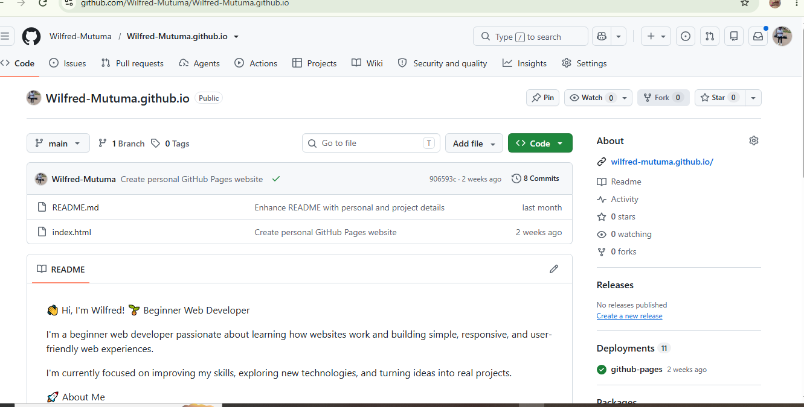

# Wilfred Mutuma - Week 03 Project

## Project Overview

Welcome to my Week 3 portfolio project for the IYF Weekend Academy Season 12 program. I am an Electrical Engineer and Security Systems Specialist developing my web development skills.

This project builds on my Week 2 portfolio and demonstrates my progress in HTML, CSS, command-line tools, Git, and GitHub collaboration workflows.

## Live Demo

- **Week 3 Portfolio:** [View My Live Portfolio](https://wilfred-mutuma.github.io/iyf-s12-week-03-Wilfred-Mutuma/)
- **GitHub Repository:** [View the Week 3 Source Code](https://github.com/Wilfred-Mutuma/iyf-s12-week-03-Wilfred-Mutuma)
- **GitHub Profile:** [Wilfred-Mutuma](https://github.com/Wilfred-Mutuma)

## Screenshot



## Features

- Multi-page portfolio with Home, About, Projects, and Contact pages.
- Daily Challenges page for recording coding practice.
- Navigation between portfolio pages.
- CSS styling using an external stylesheet.
- Contact information and an email link.
- Git version control and documented development progress.
- Collaboration practice using branches, pull requests, reviews, and merge-conflict resolution.
- Project documentation using Markdown.

## Technologies Used

- **HTML5:** Webpage structure and content.
- **CSS3:** Styling and page layouts.
- **Git:** Version control, branching, commits, and merging.
- **GitHub:** Repository hosting and collaboration.
- **GitHub Pages:** Website hosting.
- **Visual Studio Code:** Code editing and development.
- **Command line:** File and directory management.

## Project Structure

```text
iyf-s12-week-03-Wilfred-Mutuma/
├── daily-challenges/
│   └── index.html
├── images/
│   └── screenshot.png
├── .gitignore
├── README.md
├── about.html
├── contact.html
├── conflict-test.txt
├── index.html
├── new-project.sh
├── projects.html
├── styles.css
└── terminal-log.md
```

## Lessons Learned

During Week 3, I practised:

- Navigating directories and managing files using the command line.
- Using terminal commands to locate files and search their contents.
- Staging, committing, and reviewing changes with Git.
- Creating branches and merging changes.
- Understanding and resolving merge conflicts.
- Connecting local repositories to GitHub using remote repositories.
- Pushing changes to GitHub and pulling updates.
- Writing meaningful commit messages.
- Collaborating through pull requests and code reviews.

## Challenges Faced

One challenge in collaborative development is managing changes made to the same file. Merge conflicts require reviewing competing changes, deciding which content to keep, and completing the merge carefully.

I also practised maintaining an organised project structure, writing meaningful commit messages, and checking that repository changes are reflected correctly on the live website.

## Future Improvements

- [ ] Add JavaScript interactivity to the portfolio.
- [ ] Implement a dark mode.
- [ ] Add project filtering.
- [ ] Improve accessibility and keyboard navigation.
- [ ] Add more completed projects.
- [ ] Test layouts across different screen sizes.
- [ ] Verify that all navigation links work correctly.

## Contact

- **Name:** Wilfred Mutuma
- **Email:** [wilfredmtm@gmail.com](mailto:wilfredmtm@gmail.com)
- **GitHub:** [@Wilfred-Mutuma](https://github.com/Wilfred-Mutuma)
- **Portfolio:** [Visit My Website](https://wilfred-mutuma.github.io/iyf-s12-week-03-Wilfred-Mutuma/)

## Collaboration

- **Partner:** [Rodricks Okoyo (@okoyo13)](https://github.com/okoyo13)
- **Pair repository:** [iyf-s12-week-03-pair-okoyo13](https://github.com/okoyo13/iyf-s12-week-03-pair-okoyo13)
- **PR I opened:** [Pull request #3](https://github.com/okoyo13/iyf-s12-week-03-pair-okoyo13/pull/3)
- **PR I reviewed:** [Pull request #4](https://github.com/okoyo13/iyf-s12-week-03-pair-okoyo13/pull/4)
- **Merge-conflict PR:** [Pull request #2](https://github.com/okoyo13/iyf-s12-week-03-pair-okoyo13/pull/2)

## License

No license file is currently documented for this project. Add a `LICENSE` file if a license is required for submission.
